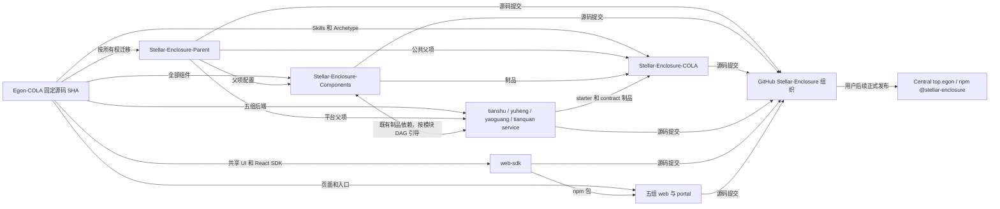
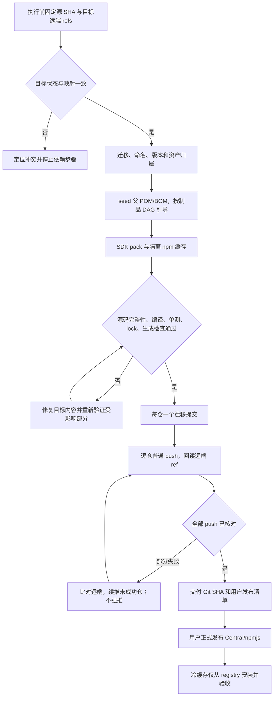
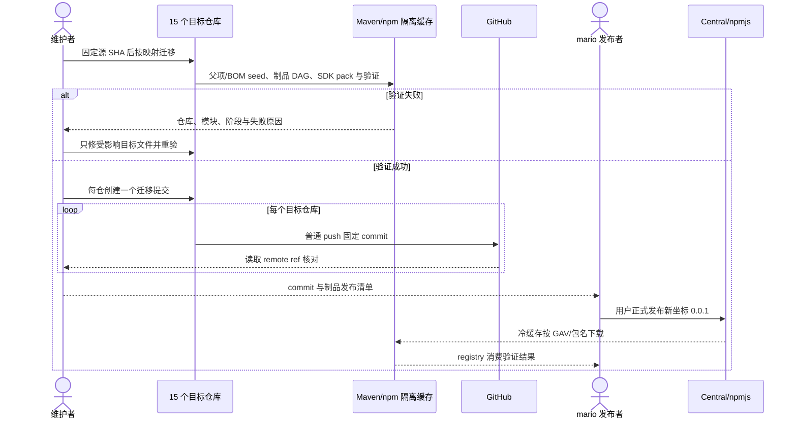

# Stellar Enclosure 多仓库迁移方案

| Field | Value |
| --- | --- |
| Document | `2026-10-21-13-58-stellar-enclosure-repository-migration.md` |
| Template Version | `9` |
| Archetype Cleanup | `Not applicable` |
| Status | `Accepted` |
| Type | `Architecture` |
| Complexity | `Complex` |
| Complexity Drivers | 15 个 Git 仓库、Maven 跨仓库依赖、npm scope 迁移至 stellar-enclosure、首次发布前构建、前端业务归属拆分与多仓库部分推送失败 |
| Created | `2026-10-21 13:58 Asia/Shanghai` |
| Updated | `2026-10-21 14:13 Asia/Shanghai` |
| Owner | mario |
| Repository | `/Users/mario/SelfProject/Egon-COLA` |
| Scope | 向 `/Users/mario/SelfProject/Stellar-Enclosure` 下既有仓库迁移源码、构建与发布准备 |
| Change Surface | 仓库所有权、项目目录与制品名、自有版本、父 POM/BOM、npm imports/lock、脚本与 CI、瑶光前端抽取；业务协议和数据库保持现状 |
| Affected Chapters | §7, §8, §9, §12, §13, §14, §15, §16, §17, §18 |
| Source Requirement | 按模块迁至目标各仓库并提交 push GitHub；skill/arche 在 COLA；组件在 Components；业务按分包；项目名 Stellar-Enclosure；发布命名空间 top.egon；所有模块版本 0.0.1；方案获准后开始迁移与 GitHub 推送；npm 组织改为 stellar-enclosure，Central/npmjs 后续由用户发布 |
| Baseline Revision | `main@52e407ee3be892200aafadb19ad912189f5ada1c`；盘点时源工作区干净 |
| Amends | None |
| Supersedes | None |
| Depends On | None |
| Related Specs | None |
| Related Plans | None |

## 1. Summary

采用现有 15 个目标仓库完成源码拆分。`Stellar-Enclosure-Parent` 承载公共构建父项及现有平台父项；`Stellar-Enclosure-Components` 保留全部现有 Java 组件；`Stellar-Enclosure-COLA` 承载 Skills、7 类 Archetype 的源项目/定义/验证与生成工具。五组业务各自拆成 service/web，Portal 单独管理，共享前端 UI 与鉴权 React SDK 进入 `web-sdk`。

自有 Maven artifactId、模块目录、项目展示名和 npm 包的项目部分统一采用 `stellar-enclosure` 前缀，首版统一 `0.0.1`。Maven groupId 保持 `top.egon` 及已存在的自有子命名空间；按本次要求，npm 的目标 scope 为本轮用户指定的新组织 `@stellar-enclosure`。现有 npm scope 实际为 `@egon-cola`，所以这里属于一次显式包身份迁移。

迁移以当前源码快照为输入，推荐每个目标仓库一个聚焦的初始提交，保留旧仓库作为历史追溯来源。迁移执行负责 GitHub 源码推送和发布前验证；Central/npmjs 的正式发布由用户执行。2026-10-21 用户认可迁移并将 npm 组织修正为 stellar-enclosure；后续执行源码迁移、验证、提交与 GitHub push，Central/npmjs 正式发布继续由用户执行。

## 2. Background and Current State

### 2.1 Business and user context

现有单仓库同时聚合组件、平台服务、前端、Archetype 和开发规范。用户已经准备目标仓库，希望仓库边界与业务归属一致，并启用新的项目品牌和版本起点。

以下源路径均相对当前仓库；目标路径均相对 `/Users/mario/SelfProject/Stellar-Enclosure`。迁移应复制经过清点的源码到各目标仓库，不在旧目录中直接执行破坏性移动。

### 2.2 Repository evidence

| Evidence ID | Classification | Exact path/symbol/decision/command | Observed fact | Design significance | Verification limit/freshness |
| --- | --- | --- | --- | --- | --- |
| EVD-001 | Static repository | 根 `pom.xml` 的 GAV、modules | `top.egon:egon-cola-aggregation-parent:5.4.1` 聚合 Components、Xingyuan、Archetypes | 拆开继承与跨仓库聚合 | 本轮读取 |
| EVD-002 | Static repository | `git ls-files` 中的 POM/package.json XML/JSON 盘点 | 150 个受版本管理 POM：root 1、Components 61、Xingyuan 45、Archetypes 43；9 个 package.json | 必须覆盖显式版本、继承版本、样板源和测试构建文件；150 不等于发布制品数 | 排除 target、node_modules、忽略的生成目录 |
| EVD-003 | Static repository | 15 个目标目录的 Git status、HEAD、origin | 均有 .git 和组织 `Stellar-Enclosure` 下对应 origin，本地 main 尚无初始提交 | 可以按既有仓库名迁移 | 仅证明本地配置；GitHub connector 未列出组织仓库，不证明远端为空或具有 push 权限 |
| EVD-004 | Static repository | `egon-cola-components/egon-cola-component-rpc/egon-cola-component-rpc-tianshu-adapter/pom.xml` | 组件适配器依赖天枢 starter、守柄 starter | 组件仓库整仓先发布不可作为首次构建顺序 | 直接依赖已核对 |
| EVD-005 | Static repository | 天枢 starter/http-registration-starter、守柄 core/starter 及各业务 POM | 守柄 starter 使用 RPC 基础；天枢基础 starter 使用守柄 starter；高层 starter/admin 使用组件适配器 | 仓库级互相依赖要按制品级顺序引导 | 静态直接依赖有拓扑层次，未执行完整 effective-POM 构建 |
| EVD-006 | Static repository | `egon-cola-archetypes/source-projects/pom.xml` | modules 直接包含 `../../egon-cola-components` 和 `../../egon-cola-xingyuan` | 必须移除跨仓库源码聚合 | 7 类 definitions 已存在 |
| EVD-007 | Static repository | 共享 Web 与 Jianshen SDK 的 `package.json`、应用依赖 | 发布包为 `@egon-cola/admin-web-shared`、`@egon-cola/tianquan-jianshen-react-sdk`；应用还有 npm 别名指向旧包 | scope、imports、exports、lock、包元数据须一起迁移 | 未检查 npm 账户权限或目标包占用 |
| EVD-008 | Static repository | `egon-cola-xingyuan/egon-cola-yuheng/yuheng-admin-web/src/app/App.tsx`、`features/knowledge`、`features/wiki`、`auth/workspaceResource.ts` | 瑶光知识/Wiki 页面和鉴权分支在玉衡 Web 内 | yaoguang-web 需要业务抽取 | 旧路径、权限和 API 继续保留 |
| EVD-009 | Static repository | `scripts/generate_archetypes.sh`、`scripts/link-skills.sh`、`scripts/maven-deploy.sh`、`.github/workflows` | 生成、技能链接、发布和 CI 都依赖旧单仓库路径 | 脚本与 CI 随责任迁移，不能原样复制 | 未运行发布工作流 |
| EVD-010 | Static repository | `egon-cola-xingyuan/egon-cola-yaoguang/README.md` | 业务已有独立后端；沿用知识路由与 `yuheng:knowledge:*` 权限 | 前端拆分不能顺便重写后端协议 | README 与 App/router 共同核对 |
| EVD-011 | Local isolated tooling evidence | Node `v24.14.1`、npm `11.19.1`，临时包与隔离缓存 | 用真实 npm pack 摘要构造正式 registry 地址的 lock，再 npm ci --offline 成功 | 发布前可验证新包身份；无需提前发 npm | 仅无第三方依赖的最小实验；实际两个 SDK 的完整依赖图仍须验证，临时目录已删除 |
| EVD-012 | User decision | 本次原始要求及 AGENTS.md | 先方案；发布 top.egon；0.0.1；不启动服务；每逻辑任务至多一个 commit | 当前止于设计，实施/发布边界明确 | 持续适用 |

### 2.3 Problem statement and gap

目录复制不能独立解决父 POM 查找、BOM、跨仓库依赖、未发布的新 npm 坐标、瑶光页面归属以及旧脚本/CI 的目录假设。主要工作是保持业务代码和协议的同时重建仓库边界与构建契约。

### 2.4 Evidence and current-chain map

| Entry/trigger | Current call chain | Data read/written | External dependency | Consumers | Evidence |
| --- | --- | --- | --- | --- | --- |
| 根 Maven 构建 | 根 parent → Components/Xingyuan/Archetypes → 子模块 | 本地 Maven 缓存、构建输出 | Maven 仓库 | 所有 Java 项目 | EVD-001/004/005 |
| Archetype 发布准备 | source-projects 引入组件/业务源码 → 生成 → definitions/verifier → generated-archetypes | 忽略的 .generated 与本地制品 | Maven plugin | 新建项目用户 | EVD-006/009 |
| 前端安装构建 | 应用 package.json → 旧 scope/别名 → shared/SDK | node_modules、lock、dist | npm registry | 5 组业务 Web 与 Portal | EVD-007/008 |
| GitHub 推送/CI | 工作流在单仓库路径中编译/发布 | 远端 Git ref 与 CI 状态 | GitHub | 维护者 | EVD-003/009 |

### 2.5 Archetype example cleanup

Cleanup disposition: Not applicable

Reason: 本次迁移维护中的 Archetype 源仓库与既有业务源码，没有从 Archetype 生成新的业务项目或开展首个业务功能。`source-projects` 中样例属于生成器的生产者真源，必须保留；本次不删除业务示例、不改变历史 SQL。

## 3. Goals and Non-goals

### 3.1 Goals

准确分配全部应迁移源码及必需资源，完成项目命名和自有版本收敛，使每个目标仓库有明确构建与发布入口，并具备 GitHub 推送、首次制品发布、后续单仓库开发所需的验证证据。

### 3.2 Non-goals

不实施业务重构、功能升级、数据库迁移、历史 SQL 重写、依赖升级或认证协议更名。Java package/FQN、Java 类名、Spring Bean 名、配置前缀、环境变量、Protobuf/RPC 身份、API、OAuth/OIDC audience/client/scope、数据库/表名和缓存键按既有技术契约保留。模块重命名以目录、制品、项目元数据及工具入口为范围；Java 命名空间若也要更名，应由用户明确扩展范围后形成独立设计。

### 3.3 Change Surface and Design Depth

| Area/layer | Disposition | Exact repository evidence | Changed or preserved behavior/contract | Required Spec treatment | Chapter(s) |
| --- | --- | --- | --- | --- | --- |
| 仓库所有权、Parent/BOM、模块目录/GAV、版本 | Affected | 根及三大模块 POM，EVD-001/002/005 | 多仓库，stellar-enclosure，0.0.1 | 精确定义归属和父项边界 | §7, §8, §13, §14, §16, §17, §18 |
| Skills、Archetype、构建 CLI、CI | Affected | .agents、scripts、definitions、workflows | 新路径、生成来源、分仓验证与首次构建入口 | 定义工具合同与失败行为 | §7, §8, §9, §14, §15, §16, §18 |
| npm 包、SDK、imports、lock 与共享资产 | Affected | EVD-007/009/011 | 新 scope/包名、真实制品锁、按仓安装 | 定义发布前与发布后证据 | §7, §8, §9, §14, §15, §16, §18 |
| 瑶光与玉衡 Web 的页面归属、Portal 入口 | Affected | EVD-008/010 | 现有页面转移到 yaoguang-web，保留 URL 与权限 | 定义页面/登录/状态边界 | §8, §12, §14, §16 |
| 业务 HTTP/RPC/事件、Java 模型与层次 | Unchanged | 现有 Controller/Service/Repository、source-projects 的分层 | 请求、响应、Java 类型与业务职责保留 | 引用边界和回归要求 | §9, §10 |
| 数据库、SQL/manifest 历史、数据与事务 | Unchanged | 各模块 src/main/resources/db、EVD-010 | 字节、版本、路径相对关系、表与事务不变 | 全量校验历史文件摘要 | §11 |
| 项目运行、浏览器、线上数据库验收 | Not applicable | 用户 AGENTS.md | 本轮设计及后续默认迁移均不启动 | 明确证据边界 | §14 |

## 4. Requirements and Acceptance Criteria

| ID | Atomic requirement | Priority | Observable acceptance criteria | Source |
| --- | --- | --- | --- | --- |
| REQ-001 | 源码进入既有 15 个目标仓库 | Must | 每个应迁移文件有目标或明确归档/排除原因，无遗漏业务 | 按模块迁移至指定路径 |
| REQ-002 | Skills 和全部 Archetype 在 COLA | Must | 4 类 coding skill 及资源、7 类 Archetype 真源/definitions/verifier 在该仓库，生成物策略保留 | skill 和 arche 放 COLA |
| REQ-003 | 全部现有 Java 组件留在 Components | Must | RPC 天枢适配器等也保留；不拆出新组件仓库 | 组件依然全部放 Components |
| REQ-004 | 五组业务按 service/web 归属迁移 | Must | 各组后端完整，瑶光知识/Wiki 前端进入 yaoguang-web，SDK/Portal 归属明确 | 业务按分包 |
| REQ-005 | 自有项目和模块采用 Stellar Enclosure 品牌 | Must | 活跃模块目录/artifactId/package 名/SCM/文档入口无旧 egon-cola 项目名，允许保留的技术契约和历史有清单 | 全部模块重命名 |
| REQ-006 | Maven 保持 top.egon，npm 使用 stellar-enclosure | Must | Maven top.egon 及已有自有子命名空间；npm @stellar-enclosure；无转到新域名命名空间 | 原始要求及本轮 npm 组织 stellar-enclosure 修正 |
| REQ-007 | 自有模块首版统一 0.0.1 | Must | 发布 POM、内部 source 项目、生成制品、package.json、内部依赖/lock 均一致；第三方版本不变 | 全部模块版本 0.0.1 |
| REQ-008 | 拆分后构建不依赖旧仓库源码 | Must | 隔离 Maven/npm 缓存下引导成功，之后单仓库可基于制品构建；无旧绝对路径或隐式源码依赖 | 正确迁移的必要条件 |
| REQ-009 | 保留业务/数据契约及历史 SQL | Must | API、权限、配置、FQN 不变；原 SQL 及 manifest 的历史条目逐一保持 | AGENTS.md 兼容及历史规则 |
| REQ-010 | 经验证后提交并 push 各 GitHub 仓库 | Must | 每仓库一个迁移提交，远端相应 ref 等于本地 commit，失败可定位续推 | 提交 push GitHub |
| REQ-011 | 准备用户后续 Central/npmjs 发布 | Must | 发布清单、顺序、元数据及 dry-run 完整；Git push 不触发自动制品发布 | 迁移后用户自己发布 |
| REQ-012 | 经审核后执行迁移、验证与 GitHub 推送 | Must | 按本轮授权实施；不正式发布 Central/npmjs，不启动应用或 GUI | 先方案，随后开始迁移 |

### 4.1 Scenario matrix

| Scenario | Actor/trigger | Preconditions | Main path | Alternative/failure path | Data/state change | Observable result | Requirements |
| --- | --- | --- | --- | --- | --- | --- | --- |
| 接受方案后的正常迁移 | 维护者 | 记录源 SHA 和目标 refs | 按映射迁移、命名、版本及验证 | 清点不一致时修正清单 | 目标源码 | 源码归属完整 | REQ-001–009 |
| 首次构建，无新坐标缓存 | 构建者 | 新包尚未公开发布 | 父项/BOM seed，再按制品 DAG 引导 | 真实制品环或缺项直接停止并诊断 | 隔离缓存与临时 reactor | 无旧 5.x 制品兜底 | REQ-007/008 |
| 新 npm 包尚未发布 | 前端构建者 | 两个 SDK 本地打包 | 使用真实 tarball 摘要、registry lock、隔离缓存验证 | 安装失败则修正依赖图，不假造 integrity/metadata | 临时缓存；正式 lock | 各 Web 可完成发布前构建 | REQ-006–008/011 |
| 瑶光深链接与权限 | 业务用户 | 旧 URL/权限 | 在新的瑶光构建中解析原知识路由及登录 | 无权限保持 denied，过期登录保持原恢复逻辑 | 前端构建归属变化 | 不放宽权限或切错 workspace | REQ-004/009 |
| 某一仓库 push 中断 | 维护者 | 本地提交与验证已完成 | 读远端 ref，重试尚未推送者 | 远端变化停止该仓库，保留其他结果 | 各仓独立 ref | 成功/失败明细可追溯 | REQ-010 |
| 用户正式发布后冷启动安装 | 用户/构建者 | 新包可从 registry 获取 | 不用迁移本地缓存重新构建 | 缺包、签名或传播延迟按发布清单处理 | 正式制品已可消费 | registry 端到端验收 | REQ-011 |

### 4.2 Use-case analysis

#### 4.2.1 Actor inventory

| Actor ID | Actor/role | Goal and responsibility | Entry/channel | Permission/tenant context | Evidence |
| --- | --- | --- | --- | --- | --- |
| ACTOR-001 | 代码维护者 | 审核方案、执行迁移、提交推送 | 本地 Git/构建 CLI | 目标仓库写权限；不使用业务用户身份 | 用户要求 |
| ACTOR-002 | 构建与 CI 执行者 | 发布前构建、单仓库构建与报告 | Maven、npm、GitHub Actions | 只读源码；发布前无生产凭据需求 | EVD-009 |
| ACTOR-003 | 制品发布者 mario | 正式发布 top.egon 0.0.1 制品 | Central/npmjs | 分别拥有发布 namespace/scope 权限 | 用户保留的后续步骤 |

#### 4.2.2 Use-case artifact

| ID | Use case/goal | Primary actor | Supporting actors/systems | Trigger | Preconditions | Main success outcome | Alternatives/failures | Postconditions | Requirements | Interfaces/pages | Tests |
| --- | --- | --- | --- | --- | --- | --- | --- | --- | --- | --- | --- |
| UC-001 | 形成可审核的多仓库迁移结果 | ACTOR-001 | ACTOR-002、GitHub | 方案获准后执行 | 源 SHA、目标 refs 固定 | 源码完整、验证通过且各仓提交可追溯 | 路径冲突/源变化/部分 push 失败 | 成功者记录 SHA，失败者保留状态和诊断；旧仓可继续使用 | REQ-001–010/012 | 第 8 章映射、Git | TEST-001–008 |
| UC-002 | 在正式发布前验证全套新坐标 | ACTOR-002 | 本地 Maven/npm | 本地或 CI 验证 | 已迁移源码、隔离缓存 | 使用 0.0.1 构建并生成真实发布准备物 | 缺包/真实环/锁不一致时退出，不借用旧制品 | 无公开发布，失败可修复重跑 | REQ-005–009/011 | CLI-001/002 | TEST-002–007 |
| UC-003 | 正式发布并验证单仓库消费 | ACTOR-003 | Central、npmjs、GitHub | 用户后续发布 | 发布清单与验证物齐备 | 新坐标从 registry 可解析 | 权限/重名/缺包/传播失败 | 按包身份记录已发布状态，后续版本前进修复 | REQ-006/007/011 | 既有发布入口按仓适配 | TEST-009 |

## 5. Constraints, Assumptions, and Decisions

### 5.1 Confirmed constraints

源项目与目标仓库的既有数据及 Git 元数据必须保留。用户提供的 AGENTS.md 对本任务优先适用：不启动运行进程、不用 GUI，不修改历史 Flyway，不混入无关变化，每逻辑任务至多一个提交。用户已在本轮明确授权按修正后的方案开始迁移；按每仓一个逻辑迁移提交执行，不额外请求确认。

### 5.2 Small-gap assumptions

| ID | Inference | Repository evidence | Why locally reversible | Impact if wrong |
| --- | --- | --- | --- | --- |
| ASM-001 | 沿用 15 个现有 Git 仓库名；目录内模块名/制品名采用统一品牌前缀 | EVD-003，用户指定每个仓库 | 方案批准前可以调整映射 | 若用户连仓库短名也要统一，需要另改 origin/远端仓库名 |
| ASM-002 | 推荐从当前源码快照创建各仓一个迁移提交，旧仓保留历史 | 目标本地无初始提交 | 尚未执行，旧历史始终保留 | 若要求各仓完整历史，应改为专门的历史拆分方案 |
| ASM-003 | Java package/FQN 等既有技术契约保留 | 用户明确说模块名字；AGENTS.md 要求兼容 | 本轮尚未变更 | 用户若要求 Java 命名空间去 cola，涉及全量 FQN/反射/元数据及协议评估 |

### 5.3 Resolved decisions

| ID | Decision | Decision owner | Evidence and rationale | Requirements |
| --- | --- | --- | --- | --- |
| DEC-001 | Skills/Archetypes、Components、业务分别按指定仓库归属 | 用户 | 直接要求 | REQ-001–004 |
| DEC-002 | Maven top.egon、npm 目标 @stellar-enclosure，自有版本 0.0.1 | 用户；方案落实精确语法 | EVD-007/012；npm 与 Maven 是两个权限域 | REQ-005–007 |
| DEC-003 | 保留组件适配器位置，以制品 DAG 引导首次构建 | 方案设计 | EVD-004/005；避免为迁移重构业务依赖 | REQ-003/008 |
| DEC-004 | 当前止于设计；正式制品由用户发布 | 用户 | EVD-012 | REQ-011/012 |

### 5.4 Open major decisions

没有阻碍本方案交付的架构决策。第 5.2 节为待用户审核的推荐边界；发布权限、远端 refs 与包身份占用属于执行前须实查的外部条件，不能据本地配置宣称已满足。

## 6. Project Technology Context

| Concern | Current choice | Repository evidence | Constraint on design |
| --- | --- | --- | --- |
| Java 与构建 | Java 21、Maven Wrapper、Spring Boot 3.5.16 | 根与模块 POM、ci-backend.yml | 保持版本和构建生态 |
| 前端 | Node 24 CI、npm、TypeScript/Vite、Vitest、React | ci-frontend.yml 与 package.json | 使用既有工具；测试用 run 模式 |
| 数据库变更 | 各模块已有 Flyway 历史与受管 db/egon-mp/manifest | 资源目录、瑶光 README | 整体按原模块复制，历史摘要不变 |
| Archetype | 7 类 source-projects/definitions、忽略的 .generated、生成/校验/Invoker | EVD-006/009 | 先真源后生成，保留 Native/Open 区别和独立 facade 发布规则 |
| 发布 | Central release profile、sources/javadoc/signing；npm publishConfig | 根 POM 与发布工作流 | 按仓修复元数据与发布入口，不自动公开发布 |

### 6.1 Java architecture profile and capability baseline

架构选型不变：既有业务后端保持其当前 controller → service → repository → DAO/XML 结构；基础组件保持技术实现边界；Archetype 真源逐家保持原 Light、Service、Web、Open、Agent 精确结构和 verifier。没有把这些不同用途的仓库合并成新业务架构，也不将旧业务重新生成为另一个 Archetype。此为现有源码迁移，`egon-coding-create-new-module` 的“新建业务项目”触发条件不适用。

| Need | Spring/JDK candidate | Spring Boot Starter candidate | Egon-COLA/module candidate | Proven gap | Decision/dependency impact |
| --- | --- | --- | --- | --- | --- |
| 公共构建治理 | Maven parent/pluginManagement | 既有 Boot parent | 根 POM、Xingyuan parent | 仅位置与 SCM 变更 | 提取原配置，保留覆盖优先级 |
| 组件版本治理 | dependencyManagement | 既有 BOM | Components BOM | 跨仓首次解析 | 保留独立 BOM，引导先安装 |
| Archetype 生产 | Maven archetype plugin | 不适用 | source-projects/definitions/generate/check | 旧跨根路径 | 迁移原工具，修复路径 |
| 前端复用 | npm workspaces/pack/cache | 不适用 | admin-web-shared、jianshen-react-sdk | 新坐标未发布 | 按真实包构建/缓存；不增加私服或打包框架 |
| RPC 平台集成 | 既有接口 | 既有 RPC starter | rpc-tianshu-adapter、Tianshu/Shoubing starters | 仓库级闭环 | 保留原 Adapter，制品级引导 |

### 6.2 User-mandated Java rule compliance

| Literal rule | Affected? | Repository evidence | Exact design decision | Files/types/interfaces | Validation/test evidence | Status/blocker |
| --- | --- | --- | --- | --- | --- | --- |
| Rule 1 | No | 当前 Java 类型只迁移文件位置，FQN/名称不改 | 不新增或重命名 Java 载体 | 现有 Java 源文件 | TEST-001/006 保持类型与业务语义 | N/A |
| Rule 2 | No | Controller/Service/Repository 输入边界保留 | 不改校验与分组 | 现有边界代码 | TEST-006 | N/A |
| Rule 3 | No | 模型/转换器内容保留 | 不改 class/record/Lombok/MapStruct | 现有模型/Converter | TEST-006 | N/A |
| Rule 4 | No | Spring Bean 与构造注入内容保留 | 不改 Bean 名/Qualifier/日志 | 现有 Java 与 lombok.config | TEST-006 | N/A |
| Rule 5 | No | 无新增 Java 工具或依赖 | 仅改自有制品坐标 | POM 依赖清单 | TEST-002 比较第三方依赖 | N/A |
| Rule 6 | No | 序列化与枚举规则保留 | 不改 Jackson/JSON | 现有 DTO/Result | TEST-006 | N/A |
| Rule 7 | No | Spring 配置技术键保留 | 只修必要制品/构建路径，不改 profile 核心键 | application*.yml | TEST-006 profile 键比较 | N/A |
| Rule 9 | No | 没有新增/修改业务算法 | 复用既有 Adapter，不增加业务模式 | rpc-tianshu-adapter 等 | 第 13 章 | N/A |
| Rule 10 | No | 时间字段/边界保留 | 不改时间类型和转换 | 既有模型/接口 | TEST-006 | N/A |
| Rule 11 | No | 业务与各 Archetype 结构原样迁移 | 各自保留当前结构，不造混合层次 | source-projects 与 service 模块 | TEST-001/004 | N/A |

### 6.3 Time semantics and conversion contract

Time contract: Not applicable

Reason: 本次不修改业务时间字段、API 序列化、数据库时间列、计算或展示时区；日期仅用于方案/迁移证据标记，采用 Asia/Shanghai。

## 7. Architecture Design

### 7.0 Minimum-design baseline and element-necessity audit

| Proposed element | Change | Requirements | Existing/direct alternative | Concrete inadequacy of alternative | Added calls/state/coupling/failures/migration/operations | Verdict |
| --- | --- | --- | --- | --- | --- | --- |
| 公共 parent 与 platform-parent | 提取既有 | REQ-001/008 | 继续依赖旧根源码 | 目标仓无法独立解析 | 新 GAV 与发布顺序；不增加运行时服务 | Keep |
| Components 中全部组件和原 Adapter | 保留 | REQ-003 | 把适配器移出组件仓 | 违反指定归属并扩大重构 | 首发需按模块而非按整仓发布 | Keep |
| 首次本地/CI 引导入口 | 新工具入口 | REQ-008/011 | 逐仓整体构建 | 仓库级互相依赖且新坐标未公开 | 临时 reactor/隔离缓存和日志；非运行时依赖 | Add |
| web-sdk 中两个既有包 | 迁移 | REQ-004/006 | 各 Web 复制共享源码 | 将造成重复维护 | 新包名、消费 imports 和 lock | Keep |
| yaoguang-web | 从已有页面抽取 | REQ-004 | 只填空 README 或复制整套玉衡应用 | 未实现按业务归属拆分 | 独立应用入口和鉴权绑定回归 | Add |
| 新依赖/私服/新业务接口/新业务设计模式 | 不引入 | REQ-009 | 复用 Maven/npm 和现有代码 | 无缺口 | 无新增运行时成本 | Remove |

业务页面操作的后端网络调用数量、请求状态机和服务端业务状态不变；构建阶段增加独立制品解析与发布准备步骤，不增加业务 API 往返。

| Path | Network calls | Client states | Server contracts/state | Failure and TOCTOU points | Additional user/business value |
| --- | --- | --- | --- | --- | --- |
| 原业务页面操作 | 保持原 API 调用数量 | 原加载、空态、成功、拒绝与错误状态 | 现有业务协议与数据 | 现有失败/并发语义 | 迁移前基线 |
| 迁移后页面操作 | 与原页面相同 | 原状态保留，只改变应用归属 | 同一业务协议与数据 | 深链接、身份资源与缓存归属需要专项回归 | 仓库与业务所有权一致，无新增业务往返 |
| 首次构建/发布准备 | 构建期拉取依赖，非业务请求 | CLI 阶段状态 | 临时 reactor、缓存、包摘要和提交清单 | 缺包、真实环、摘要不符、远端 ref 变化 | 新坐标在公开发布前有可审阅验证物 |

### 7.1 System Architecture Design

#### 7.1.1 Architecture Mermaid view



#### 7.1.2 Boundary and responsibility table

| Module/component | Capability and data owned | Inputs/outputs | Allowed dependencies | Forbidden responsibility | Requirements |
| --- | --- | --- | --- | --- | --- |
| Parent | 通用父项、现有平台父项、迁移/首发清单 | POM、构建规范、引导工具 | Boot 和既有管理项；platform-parent 导入 Components BOM | 不承载业务 Java、不成为常态全仓源码父聚合 | REQ-001/008/011 |
| Components | 全部原 Java 组件、BOM、code-generator | library/starter/plugin | 保留既有必要业务 starter 依赖 | 不外移 RPC Adapter、不复制业务服务 | REQ-003 |
| COLA | Skills/引用资源、Archetype 真源/definitions/verifier | Skills、Archetype、必要已解析 facade 制品 | 新 Components 和业务制品 | 不把兄弟仓库列入普通 source-projects modules | REQ-002 |
| 各 service | 对应业务源码/配置/SQL/测试 | 服务、contract、starter、adapter | 既有语义的新坐标依赖 | 不直读其他仓源码、数据库所有权不变 | REQ-004/009 |
| web-sdk | 共享 UI 与鉴权 React SDK | 两个可发布 npm 包 | 现有第三方库 | 不含业务整页、不复制其他仓源码 | REQ-004/006 |
| 各 web/portal | 对应页面、路由、构建、客户端测试 | 独立前端构建 | SDK npm 制品、原业务 API | 不引用兄弟仓 src，不重写后端权限 | REQ-004/009 |

### 7.2 High-Level Design

#### 7.2.1 Critical business/control flowchart



#### 7.2.2 High-level decision and quality matrix

| Concern/use case | Required behavior | Selected mechanism | Failure/degradation behavior | Trade-off | Verification | Requirements |
| --- | --- | --- | --- | --- | --- | --- |
| 完整性 | 文件无遗漏与误分 | 每个源码路径对应目标或有原因的排除 | 缺项不提交 | 增加映射清点 | TEST-001 | REQ-001–004 |
| 可构建 | 不依靠旧仓/5.x 缓存 | 隔离仓库、真实制品 DAG | 缺项/环明确失败 | 首次构建有引导成本 | TEST-002/003 | REQ-007/008 |
| 兼容性 | 不改数据/协议 | 技术标识保留、历史 SQL 字节校验 | 摘要漂移阻断 | 旧技术命名保留 | TEST-006 | REQ-009 |
| 可恢复 | 多仓 push 部分成功可续推 | repo + commit + remote ref 清单 | 逐仓读取并核对未知结果 | 不存在跨仓原子事务 | TEST-008 | REQ-010 |
| 发布控制 | 用户明确执行制品发布 | push CI 仅构建；发布手动入口 | 权限/占用失败保留诊断 | 首次发布需按制品清单 | TEST-007/009 | REQ-011 |

### 7.3 Detailed Design

#### 7.3.1 Naming, version, and parent rules

- Git 仓库沿用当前既定名字。Maven artifactId/模块目录用小写 `stellar-enclosure-*`；展示名称用 `Stellar Enclosure` 或原仓库正式拼写。
- 公共父项：`top.egon:stellar-enclosure-parent:0.0.1`。由旧 aggregation-parent 提取公共设置，去除跨仓业务 modules。
- 平台父项：`top.egon:stellar-enclosure-platform-parent:0.0.1`，在 Parent 的 `platform-parent/pom.xml`；复用旧 Xingyuan dependencyManagement/plugin 配置，去除五组业务 modules。它继承公共 parent，并导入 Components BOM。
- Components 根：`stellar-enclosure-components-parent`，BOM 为 `stellar-enclosure-components-bom`，都在 Components。BOM 保持当前独立 POM 形态，避免必须先解析依赖它的组件 parent。
- COLA 根 POM 为本仓聚合器 `stellar-enclosure-cola`，只聚合本仓并跳过公开发布；下层 `stellar-enclosure-archetypes/pom.xml` 是可发布的 `stellar-enclosure-archetypes-parent`，直接继承公共 parent，不能继承未发布聚合器。7 类 `stellar-enclosure-archetype-*`、`stellar-enclosure-source-*` 与内部 source 聚合统一迁移。
- 业务根与子模块统一 `stellar-enclosure-tianshu*`、`stellar-enclosure-yuheng*`、`stellar-enclosure-yaoguang*`、`stellar-enclosure-tianquan-jianshen*`、`stellar-enclosure-tianquan-shoubing*`。原来只有 `yuheng-*`/`yaoguang-*` 的制品也补前缀。
- 跨仓 parent 使用明确 GAV 与空 `<relativePath/>`；仓内 parent 使用本仓相对路径。常态 POM、tsconfig/Vite/import 不引用相邻仓源码。
- 自有公开及内部项目版本都是 `0.0.1`，包含 Archetype sourceVersion、生成制品和被发布的 facade；内部 sourceGroupId 保留现有 `top.egon.internal.archetype.source`。第三方 GAV、版本和标准协议不更名。
- 跨仓依赖使用独立的生产者版本属性，首版值全部为 `0.0.1`；不再默认令消费者的 project.version 代表其他仓库将来的版本。仓内同版模块仍可使用 project.version。
- 包元数据的 url/scm/issues/repository/homepage 指向各自 `github.com/Stellar-Enclosure/对应仓库`；保留原许可与作者归属。构建产物名、Docker COPY 的 jar 路径、脚本/文档命令同步更新，运行时 serviceId 等技术身份保留。

| Existing identity | Target identity | Version |
| --- | --- | --- |
| top.egon:egon-cola-component-common-core | top.egon:stellar-enclosure-component-common-core | 0.0.1 |
| top.egon:egon-cola-component-rpc-tianshu-adapter | top.egon:stellar-enclosure-component-rpc-tianshu-adapter | 0.0.1 |
| top.egon:egon-cola-tianshu-admin | top.egon:stellar-enclosure-tianshu-admin | 0.0.1 |
| top.egon:yuheng-core | top.egon:stellar-enclosure-yuheng-core | 0.0.1 |
| top.egon:egon-cola-archetype-web | top.egon:stellar-enclosure-archetype-web | 0.0.1 |
| @egon-cola/admin-web-shared | @stellar-enclosure/stellar-enclosure-web-shared | 0.0.1 |
| @egon-cola/tianquan-jianshen-react-sdk | @stellar-enclosure/stellar-enclosure-tianquan-jianshen-react-sdk | 0.0.1 |
| @egon-cola/tianshu-admin-web 等私有应用 | @stellar-enclosure/stellar-enclosure-tianshu-web 等 | 0.0.1 |

所有应用和工作区根 package.json 仍设 `private: true`；两个 SDK 才配置公开发布。迁移 imports 时去除旧 npm alias 目标，包括旧 `@egon-cola/rbac3-react-sdk`；保留 SDK 的实际 exports 路径及公开类型/函数，避免顺便破坏 JS 使用合同。

#### 7.3.2 Critical-path Mermaid swimlane



#### 7.3.3 First-build bootstrap and module order

仓库级闭环不等于具体 artifact 存在依赖环。保留 Components 内适配器位置，先以实际生产模块、parent、BOM import、plugin、profile、测试依赖生成完整制品图；当前直接依赖盘点只是起点，不能代替 effective-POM 校验。

首次本地验证/首次公开发布共用如下先后约束：

1. 非递归安装公共 parent，单独安装独立 Components BOM，再安装 platform-parent 及其余父 POM。父项/BOM 的模型解析依赖也按真实顺序处理。
2. 构建基础 Components，包括 common、crypto、trace、id、RPC starter 及其真实传递前置，不先拉取 RPC 天枢适配器和跨业务测试模块。
3. 构建守柄 core/rpc-contract/starter，再构建天枢基础 starter。
4. 构建 Components 内 RPC 天枢适配器，然后天枢 http-registration/ai starter。
5. 按实际制品图构建玉衡 contract/core/runtime、两组天权 starter/gateway-adapter、玉衡高层 starter/gateway/admin、天枢/天权 admin，以及瑶光后端和跨业务测试。这里以 DAG 输出为准，不把仓库整体串成一个虚假的线性依赖。
6. 外部依赖满足后，COLA 内完成 source 真源、必要 publish-resolved-facade、7 类 Archetype 生成/校验与打包。

使用 Parent 管理的首次引导脚本和清单，在临时目录形成不发布的 Maven reactor；该临时 reactor 可以显式选入多个仓库的模块，仅用于迁移引导及联合验证。各正式仓库 POM 不固化跨仓 modules。父项/BOM 先 seed，避免模型尚未解析就声称 -am 会自动处理。解析到真实制品环时停止报告，不通过删除必要依赖、借用旧坐标或隐藏模块规避。

公开首次发布也按该制品级顺序执行，不能简单写成“Parent 整仓 → Components 整仓 → 业务整仓”。首版依赖全部可从 Central 获取后，日常每仓按自己的 reactor 构建和发布；新 clone 仍可选用引导工具。

#### 7.3.4 npm packages and locks before publication

`web-sdk` 使用本仓 npm workspace 管理 `packages/stellar-enclosure-web-shared` 和 `packages/stellar-enclosure-tianquan-jianshen-react-sdk`。前者拥有现有共享 UI、鉴权客户端、Vite plugin 和打包所需 favicon；后者拥有现有 Jianshen React SDK。跨仓消费最终写正式新包名及精确 `0.0.1`，首版不依赖旧包 alias。

发布前流程为：先构建真实 SDK 并 npm pack，保存 tarball 的真实 integrity/文件清单；用它完成临时消费依赖图和缓存准备；正式 lock 中自有包节点使用正式 registry 地址与真实摘要，根依赖仍为 `0.0.1`，不提交 file:、本机路径或指向兄弟 src 的链接。隔离缓存预装这些真实 tarball，再执行各应用 npm ci --offline 与正式 build/test。第三方锁定版本应尽量保留，只调整迁移必须改变的节点。

EVD-011 已证明无外部依赖的最小模式可行；两个真实 SDK 的 transitive/peer/optional dependencies、Vite plugin 子路径、postbuild 行为和各 app lock 必须逐个验证。若实际依赖图无法完成同等验证，明确标为发布前阻断，修复该工具流程；不提交编造的 integrity，也不把临时 workspace 构建说成单仓 npm ci 成功。

用户后续发布与锁一致的已核验 tarball；发布后用无预热缓存的普通 npm ci 复验 registry。构建产物和缓存属于本地交付准备，不提交至 Git。npm 包 scope 的使用需要对相应用户名/组织拥有权限，Maven top.egon 权限不会自动赋予 npm 权限，见 [npm scopes](https://docs.npmjs.com/about-scopes/)。

#### 7.3.5 Failure semantics, recovery, and observability

| Failure point | Detection | Immediate control flow | Data/transaction state | Retry and idempotency | Caller/frontend result | Recovery/reconciliation owner | Verification |
| --- | --- | --- | --- | --- | --- | --- | --- |
| 源码或目标发生并发变化 | 源 SHA、工作区 diff、目标 ref | 停止相应迁移步骤 | 保留旧仓与目标现场 | 重新盘点，不能覆盖用户变化 | 明确仓库和路径 | 维护者 | TEST-001/008 |
| 构建缺坐标/真实环 | Maven 模型/图/编译错误 | 不进入提交阶段 | 仅临时缓存/target | 修复清单或必要引用后重跑 | 报 repo、artifact、phase | 维护者 | TEST-002 |
| npm lock 或 tarball 不一致 | npm ci/integrity 校验 | 停止对应前端构建 | 无 registry 写入 | 从真实 pack 重新生成迁移节点 | 报包名和失败阶段 | 维护者 | TEST-003 |
| push 返回失败或结果未知 | git exit 与远端 ref | 回读已推送 commit 是否存在 | 各仓 ref 独立，可能部分成功 | 按 repo+commit 核对后仅重推未到达者；不自动无限重试 | 成功/失败表 | 维护者 | TEST-008 |
| 远端已有其他提交 | ls-remote/fetch 与基线不符 | 保留远端并停止该仓 push | 不强推不改历史 | 分析差异后普通整合 | 列出冲突仓库 | 维护者 | TEST-008 |
| 用户发布权限/版本冲突 | 正式 registry 响应与只读预检 | 不覆写已发布身份 | 公开版本可能已经存在 | 用户处理权限；不可覆写版本须前进新版本 | 精确列出包身份与状态 | 用户发布者 | TEST-009 |

迁移报告按 repo、源 SHA、目标 commit、验证阶段、结果、包身份、tarball/hash、远端 ref 记录，禁止包含凭据和私钥。无数据库写事务；多仓提交/push 没有跨仓原子性，恢复依据实际远端状态。工具失败即停依赖阶段，保留成功状态，不启动后台补偿服务。

#### 7.3.6 Conclusion evidence chain

| Conclusion | Repository/user evidence | Constraint or requirement | Design decision | Consequence and trade-off | Verification and acceptance evidence |
| --- | --- | --- | --- | --- | --- |
| 保留组件仓库边界并按制品引导 | EVD-004/005，用户全部组件留 Components | REQ-003/008 | 不移动 Adapter，使用首次 DAG 引导 | 首发流程较逐仓发布复杂，避免业务结构变化 | TEST-002 的隔离构建 |
| 瑶光 Web 按现有功能抽取 | EVD-008/010，已存在 yaoguang-web 目标 | REQ-004/009 | 迁移 knowledge/wiki、绑定原鉴权资源 | 需针对路由、权限与缓存回归 | TEST-005 |
| GitHub push 与制品发布分离 | EVD-009/012 | REQ-010/011 | 自动 CI 只验证，正式发布用户触发 | 交付时 registry 冷安装仍待发布 | TEST-007/009 |
| 新 npm 坐标可在发布前实证验证 | EVD-007/011 | REQ-006–008 | 真实 pack 摘要与隔离缓存 | 真实依赖图仍须完整验证，禁止假摘要 | TEST-003 |

## 8. Package Structure and Code File Tree

### 8.1 Current relevant tree

```text
Egon-COLA/
├── pom.xml / .mvn / mvnw / mvnw.cmd
├── .agents/skills/  (4 个 coding skill 及其资源)
├── egon-cola-components/
├── egon-cola-archetypes/  (source-projects / definitions / 忽略的 .generated)
├── egon-cola-xingyuan/
│   ├── egon-cola-tianshu/
│   ├── egon-cola-yuheng/  (含知识/Wiki 前端)
│   ├── egon-cola-yaoguang/
│   ├── egon-cola-tianquan-jianshen/  (含 React SDK)
│   ├── egon-cola-tianquan-shoubing/
│   ├── egon-cola-xingyuan-admin-web-shared/
│   └── egon-cola-xingyuan-admin-portal/
└── scripts / docs / .github / LICENSE*
```

### 8.2 Target tree and repository allocation

| Target repository | Source | Target contents |
| --- | --- | --- |
| Stellar-Enclosure-Parent | 根 pom、Xingyuan pom 中通用平台父项、共同构建/发布说明 | 根 stellar-enclosure-parent；platform-parent；Wrapper；首发清单与 bootstrap/发布工具；总迁移说明 |
| Stellar-Enclosure-Components | egon-cola-components 全部源码 | components parent、BOM、全部原组件及测试、组件专用检查/构建工具 |
| Stellar-Enclosure-COLA | .agents/skills、egon-cola-archetypes、生成/技能工具 | .agents/skills/stellar-enclosure-coding-*；stellar-enclosure-archetypes/source-projects/definitions；生成/verifier/check；skill 治理文档 |
| tianshu-service | egon-cola-xingyuan/egon-cola-tianshu 排除 admin-web | 业务 parent、starter、http-registration、ai、admin、test、原配置/SQL/文档 |
| tianshu-web | 上述 egon-cola-tianshu-admin-web | 对应应用源码、资源、测试、配置与 lock |
| yuheng-service | egon-cola-xingyuan/egon-cola-yuheng 排除 admin-web | 所有 contract/core/runtime/gateway/starter/admin/test、部署定义和模块文档 |
| yuheng-web | 上述 yuheng-admin-web 排除转给瑶光的功能 | 网关、MCP、LLM 配置、发布及观测等玉衡功能 |
| yaoguang-service | egon-cola-xingyuan/egon-cola-yaoguang | 原 parent 与 yaoguang-admin、完整配置/SQL/测试/文档 |
| yaoguang-web | yuheng-admin-web 中 knowledge/wiki、api/knowledge.ts、api/wiki.ts 与必要现有外壳 | 独立瑶光入口、原知识/Wiki 页面、鉴权/权限边界及测试 |
| tianquan-jianshen-service | egon-cola-xingyuan/egon-cola-tianquan-jianshen 排除 admin-web/react-sdk/npm workspace | contract/core/starter/gateway-adapter/admin、业务配置/SQL/测试 |
| tianquan-jianshen-web | 上述 egon-cola-tianquan-jianshen-admin-web | 权限业务前端；SDK 改为 web-sdk 包依赖 |
| tianquan-shoubing-service | egon-cola-xingyuan/egon-cola-tianquan-shoubing 排除 admin-web | core/rpc-contract/starter/gateway-adapter/admin、业务配置/SQL/测试 |
| tianquan-shoubing-web | 上述 egon-cola-tianquan-shoubing-admin-web | 身份业务前端 |
| portal | egon-cola-xingyuan/egon-cola-xingyuan-admin-portal | Portal、manifest/bridge/lifecycle、子应用入口测试 |
| web-sdk | admin-web-shared 与 jianshen-react-sdk | 两个 npm workspace 包、各自 README/exports/tests、共享 favicon 所有权 |

各后端仓库获得本仓 Wrapper、必要 .editorconfig/.gitignore/许可文件和 README；只拥有自己的源码模块。各前端仓库获得本仓 package.json、真实 lock、Vite/TS/ESLint 配置、公开环境变量模板及 CI。

```text
Stellar-Enclosure-Parent/
├── pom.xml
├── platform-parent/pom.xml
├── scripts/bootstrap-migration.sh
├── scripts/maven-deploy.sh
└── migration/repositories.json

Stellar-Enclosure-COLA/
├── pom.xml
├── .agents/skills/stellar-enclosure-coding-{writing-spec,writing-plan,executing-plan,create-new-module}/
├── stellar-enclosure-archetypes/
│   ├── pom.xml
│   ├── source-projects/
│   └── definitions/
└── scripts/{generate_archetypes.sh,check_archetypes.sh,link-skills.sh}

web-sdk/
├── package.json
├── package-lock.json
├── scripts/verify-migration-consumers.mjs
└── packages/
    ├── stellar-enclosure-web-shared/
    └── stellar-enclosure-tianquan-jianshen-react-sdk/
```

### 8.3 Package and file responsibilities

| Operation | Path/package | Symbols | Responsibility | Dependencies | Requirements |
| --- | --- | --- | --- | --- | --- |
| Copy/Adapt | 各目标仓库 pom.xml 与原子模块 pom.xml | GAV、parent、modules、DM、release | 新命名/版本/父路径/SCM | 既有依赖新坐标 | REQ-005–008 |
| Copy/Rename | COLA .agents/skills 下四类 skill 与全部资源 | frontmatter name、SKILL.md/中文镜像、引用路径、agents/openai.yaml | skill 标识 stellar-enclosure-coding-*；保留技术规则与历史引用的语义 | 随 skill 自带的 validators/tests | REQ-002/005 |
| Adapt | COLA scripts/link-skills.sh、Skills 中源码定位 | SOURCE_ROOT、组件/CLI 位置发现 | 开发机可链接 COLA 的规范，不提交跨仓绝对 symlink | COLA 与制品化工具 | REQ-002/008 |
| Copy/Adapt | COLA stellar-enclosure-archetypes/source-projects/pom.xml、definitions/*/archetype.properties、verifier/打包 POM | sourceProject/ArtifactId/Version、targetArtifactId | 去跨仓源码 modules，保持七家拓扑 | 新父项、Components/业务制品 | REQ-002/007/008 |
| Adapt | Components scripts/stellar-enclosure-codegen.sh（来自原 scripts/egon-codegen.sh）；COLA 的 CLI 使用说明 | 既有 CodegenCommand、classpath/资源定位 | 实现属于 Components；skill 使用工具制品/本地明确 classpath | 既有 code-generator | REQ-002/003 |
| Copy/Adapt | 各 Web package.json、lock、tsconfig、vite.config、imports、tests | 新 npm 包名和正式锁 | 所有消费使用准确新包 | web-sdk | REQ-005–008 |
| Copy/Adapt | web-sdk shared 的 scripts/copy-favicon.mjs 与资源 | favicon 来源/exports | 取消依赖旧 xingyuan 上层图片位置 | 本包拥有的资源 | REQ-004/008 |
| Extract/Adapt | yaoguang-web/src 下 knowledge/wiki、api/auth/app/layout | 既有页面与路由绑定 | 独立瑶光构建和身份边界 | 两个 SDK 中所需包 | REQ-004/009 |
| Adapt | 各仓 .github/workflows、Parent scripts/maven-deploy.sh | 构建目录、制品列表、手动发布输入 | 本仓 CI；首次依赖预热显式声明；push 不触发公开发布 | 既有 Actions、Maven/npm | REQ-008/010/011 |
| Create | Parent migration/repositories.json | 仓库 origin/源 SHA/目标分配/预期 GAV/package/发布清单 | 唯一迁移映射与首发清单 | Git 与工具 | REQ-001/008/010/011 |
| Copy byte-for-byte | 每个原模块的 src/main/resources/db 及 SQL manifest | SQL 版本/文件名/内容/历史 SHA | 保留历史、无新迁移 | 原模块配置 | REQ-009 |

文档随责任分配：组件文档进入 Components；Archetype/skill/codegen 使用说明进入 COLA；业务文档随 service/web；跨仓总览、迁移/首发清单进入 Parent。历史 Spec/Plan 标注原始来源与源 commit，不批量改写历史决策；原 SQL 与 manifest 不因品牌替换而改 checksum。

仅迁移明确清单内的受版本管理源码及必要公开资产。`target`、`node_modules`、`dist`、`.runtime`、`.idea`、缓存、tsbuildinfo、.DS_Store、本机 env、密钥/证书私钥、数据库文件和任何仓库的 .git 不复制。必要 symlink 按来源处理，不能把旧 checkout 的绝对链接提交到新仓。现有 .gitmodules 中 bash-buddy 只在确认仍有消费者时迁到工具拥有仓，保留原第三方 URL，不能误装成自有模块或漏掉脚本依赖。

## 9. Interface Definitions

本次业务 HTTP/RPC/事件接口为 Unchanged。具体边界包括瑶光 README 列明的知识 API、`/api/v1/yaoguang/auth/bootstrap`、玉衡 App 中三条 `/knowledge` 路由和 `yuheng:knowledge:*` 权限；请求/响应、operationId、错误、租户、认证与文档合同保持原样。移动源码的 Java FQN、Protobuf 与 Spring 自动配置元数据保持内容不变，不创建新业务 API。

本章 Affected 的是迁移/验证工具合同。

### 9.1 Interface Inventory

| ID | Change/necessity verdict | Name/purpose | Kind | Consumer | Owner | Symbol | Input | Output | Error model | Idempotency/version | Requirements |
| --- | --- | --- | --- | --- | --- | --- | --- | --- | --- | --- | --- |
| CLI-001 | New/Add | 首次 Maven 构建引导 | CLI | ACTOR-001/002 | Parent | scripts/bootstrap-migration.sh | workspace、local-repository | 构建/验证日志与清单 | 非零退出、定位 repo/artifact | 固定源/目标 SHA 与清单摘要；不自动修改源码 | REQ-008/011 |
| CLI-002 | New/Add | 首次 npm 制品与消费验证 | CLI | ACTOR-001/002 | web-sdk | scripts/verify-migration-consumers.mjs | workspace、cache、output | pack 元数据及安装/build 结果 | 非零退出，包/阶段诊断 | 包名/version/integrity 与 lock | REQ-006–008/011 |

### 9.2 Per-interface Detailed Contracts

#### 9.2.1 CLI-001 — 首次 Maven 构建引导

##### Necessity and interaction-cost decision

仓库级互相依赖使逐仓整体构建不可行；入口复用 Maven 与现有 Shell 工具，只编排父项 seed 和临时 reactor，不新增依赖解析框架。明确 workspace 是迁移工作空间的位置，不是应用运行参数。新增成本为一份首发清单、临时 reactor 和隔离缓存。

| Concern | Decision |
| --- | --- |
| Change classification | New |
| Independent consumer goal | 维护者在新坐标尚未发布时完成可重复构建 |
| Parameter ownership and derivation | 维护者指定 workspace/cache；制品路径从本地受审清单读取 |
| Direct/no-new-interface alternative | 逐仓手动整体构建无法处理既有仓库依赖闭环 |
| Caller use of result | 构建与发布准备报告作为提交和首发依据 |
| Round trips and failure points | 只增加构建期依赖下载与本地缓存，不增加业务请求 |
| Verdict | Add；REQ-008/011，复用 Maven 排序和现有 Shell |

##### Identity and purpose

`scripts/bootstrap-migration.sh --workspace /Users/mario/SelfProject/Stellar-Enclosure --local-repository /absolute/cache/maven`。由 Parent 维护，供本地或 CI 使用；默认只构建/安装/验证，不执行 deploy、Git 写操作或服务启动。

| Concern | Definition |
| --- | --- |
| Owner / consumer | Parent；本地维护者与 CI |
| Protocol | 本地 Shell CLI；输出 UTF-8 文本和构建清单 |
| Auth / tenant | 本地路径权限；仅依赖下载可能使用现有构建凭据，无业务租户身份 |
| Side effects | 隔离缓存、构建输出和临时 reactor；不公开发布 |
| Concurrency / retries | 写目录独占；不自动重试；维护者按失败报告显式重跑 |

##### Request parameters

`--workspace` 与 `--local-repository` 都必须是明确的绝对路径；workspace 包含清单指定的 Git 根且 origin/预期源码状态一致；缓存路径不得指向源码或其他用户数据。拒绝缺失/重复/未知选项、逃逸的相对路径、未完成映射和 dirty 冲突。清单只用受审阅的本地文件，不执行从远端响应读取的命令。

| Name | Location | Type/format | Required/null | Default | Validation/range/enum | Meaning | Example | Source |
| --- | --- | --- | --- | --- | --- | --- | --- | --- |
| --workspace | CLI | absolute directory | Required，非空 | None | 包含清单指定仓库；拒绝路径逃逸 | 迁移工作空间 | /Users/mario/SelfProject/Stellar-Enclosure | 维护者 |
| --local-repository | CLI | absolute directory | Required，非空 | None | 独立缓存，不能覆盖源码/.git | Maven 验证缓存 | /absolute/cache/maven | 维护者 |

##### Success response

退出码 0；输出每个 repo/artifact 的 seed、compile、允许单元测试、package/install 结果，以及使用的源码 SHA、清单摘要和隔离缓存位置。普通阶段不运行侵入式集成测试。临时 reactor 和构建缓存不进入版本管理。

Non-JSON response: CLI 的文本阶段日志和文件清单，以上述退出码定义成功，没有 HTTP 响应体。

##### Error responses

参数/路径/清单校验返回 2；构建、真实环、缺包、编译或验证失败返回 1 并给出 repo、artifact、phase 和原始退出原因。并发引导共用同一缓存/工作目录时必须拒绝第二个写入者或使用独立目录；不自动清空用户缓存。

Non-JSON error: stderr 输出失败 repo/artifact/phase 与原始原因；退出码 2 用于输入错误，1 用于构建/验证失败。只在维护者修正原因后重跑。

##### Interface logic for frontend and consumers

校验清单/路径/源码状态，固定输入，再按第 7.3.3 节 seed 模型；组装临时模块 reactor，由 Maven 实际模型及排序确定依赖；执行编译/获准单测与制品安装；记录结果。失败即停止依赖阶段，保留已完成证据；维护者修复后显式重跑。运行中不读取/写入生产凭据，不连接业务数据库。

1. 读取维护者提供的 workspace/cache，确认所有仓库与受审清单一致。
2. 校验路径、源 SHA、目标状态与锁，失败时不执行构建。
3. 按模型依赖 seed 公共父项、独立 BOM 和平台父项。
4. 组装临时 reactor，执行 Maven 实际模型解析、编译、允许单测和安装。
5. 报告 repo/artifact/phase、清单摘要、构建结果与隔离缓存位置。
6. 失败即停；不部署、不写 Git、不连接数据库，保留可恢复现场。
7. 维护者检查诊断后显式重跑；成功报告用于后续提交/发布准备。

##### Compatibility and verification

该入口仅服务迁移首发和联合开发，不成为单仓正式构建的隐式前置。TEST-002 必须用隔离 Maven repository 验证，不能借用原 ~/.m2 中自有旧制品。Maven reactor 按实例化依赖排序，DM/pluginManagement 不能单独保证排序，见 [Maven multiple modules](https://maven.apache.org/guides/mini/guide-multiple-modules.html)。

#### 9.2.2 CLI-002 — 首次 npm 制品与消费验证

##### Necessity and interaction-cost decision

新 scope 的 0.0.1 尚未发布，需要在本地以真实 pack 制品验证消费者。复用 Node/npm/crypto 与既有 workspace/build，不增加 registry 服务。输入仅定位已迁移源码和隔离缓存。

| Concern | Decision |
| --- | --- |
| Change classification | New |
| Independent consumer goal | 在 npm 正式发布前证明 SDK 与独立 Web 可安装和构建 |
| Parameter ownership and derivation | 维护者指定目录；包身份、依赖图和摘要来自真实 manifests/pack |
| Direct/no-new-interface alternative | 普通冷 npm ci 无法获取尚未发布的新坐标 |
| Caller use of result | 使用真实 tarball/lock 和验证报告准备后续发布 |
| Round trips and failure points | 仅构建期依赖获取、本地 pack/cache；无新增业务请求 |
| Verdict | Add；REQ-006–008/011，不引入 npm 私服 |

##### Identity and purpose

`node scripts/verify-migration-consumers.mjs --workspace /Users/mario/SelfProject/Stellar-Enclosure --cache /absolute/cache/npm --output /absolute/output`；输出目录保存可供用户后续发布的真实 tarball/摘要和验证报告。脚本由 web-sdk 维护，不执行 npm publish。

| Concern | Definition |
| --- | --- |
| Owner / consumer | web-sdk；维护者与 CI |
| Protocol | Node CLI；npm pack JSON 元数据、文本阶段日志和文件报告 |
| Auth / tenant | 本地目录权限；原第三方依赖下载，无业务租户身份 |
| Side effects | 真实 pack、隔离缓存、临时消费图与迁移 lock；不执行 publish |
| Concurrency / retries | 输出/lock 写操作独占；失败后人工核对并重跑 |

##### Request parameters

三个参数均为显式绝对路径；output/cache 不能覆盖源码、.git、已有用户文件。包名、0.0.1、exports、peerDependencies、应用依赖列表来自已审核 manifests。拒绝缺失/重复/未知参数和包身份冲突。正式仓库 lock 修改只限迁移过的新包身份节点及必要依赖；不得削弱第三方完整性检查。

| Name | Location | Type/format | Required/null | Default | Validation/range/enum | Meaning | Example | Source |
| --- | --- | --- | --- | --- | --- | --- | --- | --- |
| --workspace | CLI | absolute directory | Required，非空 | None | 已迁移包/应用清单一致 | 源码工作空间 | /Users/mario/SelfProject/Stellar-Enclosure | 维护者 |
| --cache | CLI | absolute directory | Required，非空 | None | 独立 npm cache，无目录覆盖 | 安装验证缓存 | /absolute/cache/npm | 维护者 |
| --output | CLI | absolute directory | Required，非空 | None | 不覆盖源码和既有用户文件 | tarball 与报告 | /absolute/output | 维护者 |

##### Success response

退出码 0；输出两个 SDK pack 的 name/version/filename/integrity、各消费者的 npm ci --offline、build 和 run 模式测试结果；正式 lock 不含本机路径或旧包 alias。报告区分预热缓存验收和发布后的冷 registry 验收。

Non-JSON response: 阶段文本日志及 npm pack 元数据文件/报告；CLI 成功由退出码 0 表示，不提供 HTTP 响应。

##### Error responses

参数/路径错误返回 2；pack、lock/integrity、依赖安装或 build/test 失败返回 1，打印 package/repo/phase；不在失败后删除源文件或自动发布。并发写同一 lock/cache/output 使用独占执行；失败后保留可诊断文件与已核实产物。

Non-JSON error: stderr 给出包、仓库、阶段和 npm 原始错误；退出码 2 表示输入错误，1 表示制品/安装/构建失败，需修正原因后显式重跑。

##### Interface logic for frontend and consumers

构建两个 SDK，读取 npm pack --json 返回的真实元数据；在临时工作目录解析真实消费图，生成可验证的迁移 lock 节点，预热隔离缓存；各正式消费者按锁做离线安装、编译和测试；检查所有旧包引用及路径依赖均已替换；输出成功清单。首次安装第三方依赖按原 lock 准备缓存；离线消费验证不能静默联网兜底。

1. 读取目录和清单，固定待验证的包/消费者源码状态。
2. 校验正式包名、0.0.1、exports、peerDependencies 与输出写入权限。
3. 运行两个 SDK 的既有 build 和 npm pack，记录真实完整性摘要。
4. 在临时消费目录解析依赖图，准备正式 registry 形式 lock 与真实内容缓存。
5. 对各消费者执行 npm ci --offline、build 与 run 模式单测，输出结果。
6. 摘要/lock/依赖或测试失败即停止；不编造元数据、不联网兜底、不 publish。
7. 维护者核对 tarball/报告用于正式发布；发布后另做冷 registry 消费验收。

##### Compatibility and verification

SDK 导出符号和 Vite plugin 子路径继续兼容；首次版本统一 0.0.1。TEST-003 覆盖真实 SDK/各 Web，TEST-009 由用户发布后验证冷 registry。当前 EVD-011 只证明此流程的最小工具能力。

## 10. POJO and Data Model Design

Unchanged。现有 DTO/PO/BO/Result、Repository、转换器、枚举与 Java 包内容随模块复制；自有 Maven 项目重命名不要求 Java package 重命名。不新增对象或映射，不调整 validation、Jackson、Lombok、字段和持久化语义。TEST-006 比较迁移前后类型、业务语义与资源契约。允许更新 Java/测试中定位 Maven 元数据、新制品或构建目录的必要字符串；这些变化逐项列入迁移白名单，不扩展为业务逻辑或 FQN 更名。

## 11. Database Design

Unchanged。Relational model change: No — 本次只迁移现有模块目录，数据库、schema、表、索引、分片、权限、事务和 SQL 执行配置不变。Flyway 与受管 MP-DDL 的既有 SQL 文件不编辑、不重命名、不删除、不重排；manifest 的历史版本、相对路径和 checksum 条目保持原样。

迁移前为所有 `src/main/resources/db/**` 生成版本管理文件摘要，迁移后以明确路径映射逐一比较；历史 manifest 内容也比较。本任务没有新增数据库逻辑变更，所以不增加迁移版本，也不运行数据库检查/repair。ER 模型未变化，不重画 ER 图。

## 12. Frontend Page Design

前端页面职责按业务拆分，布局/表单/字段/交互文案与后端合同保留，不新增 UI 设计系统。新变更集中在知识应用归属、应用入口、共享资产路径和 Portal 指向。

### 12.1 Route, navigation, permission, and page ownership

| Page | Route/deep link | Navigation entry | Owner | Permission/tenant guard | Unauthorized/missing behavior | Requirements |
| --- | --- | --- | --- | --- | --- | --- |
| 知识库列表 | /knowledge | 现有知识库导航 | yaoguang-web | yuheng:knowledge:read 与原租户/资源 | 原 denied/login/empty 逻辑 | REQ-004/009 |
| 知识库详情 | /knowledge/:kbId | 原列表/深链接 | yaoguang-web | 原 read/write/admin 分支 | 原 403/404/错误恢复 | REQ-004/009 |
| Wiki | /knowledge/:kbId/wiki/:pageId | 原知识库导航 | yaoguang-web | 原知识权限与身份 | 原只读/拒绝/版本切换行为 | REQ-004/009 |
| 模型配置 | /llm/configuration | 原模型配置导航 | yuheng-web | yuheng:llm:read 等原规则 | 原权限/错误逻辑 | REQ-004/009 |
| 网关/MCP/发布/观测 | 当前玉衡路由 | 原导航 | yuheng-web | 原 yuheng 权限 | 原行为 | REQ-004/009 |
| 子应用入口 | Portal 既有路径/manifest | 原 Portal 导航 | portal | 原上下文桥与鉴权 | 原 manifest/lifecycle 错误处理 | REQ-004/009 |

### 12.2 Layout and component tree

`yaoguang-web` 复用当前应用壳与现有 shared 组件：

```text
main / Wujie mount-unmount
└── 原主题、查询缓存与路由装配
    └── 瑶光 AuthProvider（原 edge-yaoguang）
        └── 原 CapabilityProvider / RequireAuth
            └── 原布局中知识导航
                ├── KnowledgeBasesPage
                ├── KnowledgeBasePage
                └── WikiPage
```

从玉衡复制构建所需的既有 main/auth/app/layout/test 配置并裁剪到知识功能；仅保留真实需要的基础组件副本。已跨所有应用共享的 UI 在 web-sdk；不为一次抽取创造新的通用抽象。玉衡应用去掉知识页面依赖及菜单归属，保留 LLM 配置；旧知识 URL 的宿主/反向代理规则需由已有部署配置与 Portal 指向新的构建，使用户深链接仍可到达。

### 12.3 User flows, forms, and validation

知识搜索、文档导入/问答、Wiki 查看/编辑/发布的表单字段、校验和 API 调用从原页面完整迁移，不新增业务行为。瑶光登录固定原知识资源，不落回玉衡资源；从 Portal 进入和独立访问都使用既有 workspace=yaoguang/registrationId 语义。业务 API 保持原 /api/v1/yuheng/admin/knowledge-* 等路径。

### 12.4 UI state and API/data mapping

| UI state | Entry condition | Visible components/copy | Enabled actions | Data/cache state | Exit transition | Test |
| --- | --- | --- | --- | --- | --- | --- |
| 加载/空数据/成功 | 原知识请求开始/结果 | 原 QueryState、页面与空态 | 原权限动作 | 原 query key/data mapping | 原加载→空/成功 | TEST-005 |
| 未认证/失效 | 原 bootstrap/login 结果 | 原登录/恢复界面 | 原登录操作 | 使用瑶光资源，清理对应旧缓存 | 原恢复流程 | TEST-005 |
| 拒绝/只读 | 无 read/write/admin | 原 denied 或只读控件 | 不放宽按钮/写操作 | 保留知识缓存隔离规则 | 原授权刷新 | TEST-005 |
| API/加载失败 | 原网络/业务错误 | 原错误状态与重试文案 | 原可重试动作 | 不丢失原表单规则 | 原重试/返回 | TEST-005 |
| Portal 挂载/卸载/切换 | 子应用进入或退出 | 原子应用壳 | 原导航 | 维持 Wujie 清理与身份切换规则 | 原 mount/unmount | TEST-005 |

### 12.5 Accessibility, responsiveness, and interaction safety

保留现有组件语义、键盘/focus、响应式布局、表单防重复提交与危险操作确认。迁移专测菜单隐藏不等于权限放行、深链接守卫、知识和玉衡身份隔离、切换/卸载缓存清理；实际浏览器联调由用户后续启动后进行。

## 13. Design Patterns and Architecture Principles

本任务是源码所有权与构建迁移，没有新增复杂业务规则。已考虑 Adapter、Facade、Strategy：继续复用既有 RPC 天枢 Adapter 及 SDK 导出边界；不增加 Strategy/Factory/Registry 类，也不通过改造业务状态机处理构建依赖。制品依赖排序使用 Maven 已有 reactor 与显式前置 seed，前端包管理使用 npm 现有能力。

公共 parent 负责构建、BOM 负责版本、各业务仓拥有源码与数据库历史；保持现有 Java 层次与模块间协议。跨仓协作用制品合同，临时首发 reactor 不进入常态应用结构。

## 14. Test Design

### 14.1 Unit tests

复用现有受影响模块单元测试和前端 Vitest run 模式。迁移工具如引入路径映射、依赖排序与 lock 节点变换，应对缺失映射、路径冲突、真实环、错误退出和真实 integrity 进行聚焦验证；不添加仅断言字符串替换结果的镜像测试。

### 14.2 Integration, contract, persistence, component, and end-to-end tests

默认验证不启动项目、数据库、Redis、MQ、Docker、Playwright 或 GUI。先执行 POM/JSON/脚本静态验证和 test-compile，再执行明确不会启动基础设施的单元测试与构建；对会启动运行进程的插件/Invoker/集成测试先审计 profile，并明确跳过/未验收项。Archetype 验证生成目录中的源码/构建，不启动所生成应用。

### 14.3 Test cases and data

| ID | Level | Target | Scenario/input | Expected assertion | Test double/data | Tool/path | Requirements |
| --- | --- | --- | --- | --- | --- | --- | --- |
| TEST-001 | 静态清点 | 源/目标所有权映射 | 全部应迁移 tracked 源码/公开资产 | 文件被迁移/保留原处/有理由排除，无重复权威业务源码 | 固定源 SHA | git ls-files、映射/摘要报告 | REQ-001–004/012 |
| TEST-002 | 构建 | Maven 新坐标与父项 | 隔离缓存、空自有 namespace | seed、有效模型、test-compile、允许单测、package/install 成功；第三方版本不变 | 本次新源码制品 | Wrapper、dependency tree、effective POM、CLI-001 | REQ-003/005–008 |
| TEST-003 | 构建/消费 | 两个 SDK 与全部 Web | 真实 tarball、正式 lock、隔离 npm cache | npm ci --offline/build/run tests 成功；exports 正确；无 file:/旧 alias；产物不入 Git | 真实 pack 元数据 | CLI-002、npm pack/ci/build | REQ-004–008 |
| TEST-004 | 生成/静态与构建 | 7 类 Archetype 和 Skills | 真源/definitions、必要已解析 facade | generate/check 一致，验证生成项目；Skills 引用/中文镜像/validators 合法 | .generated 为忽略产物 | 原 generator/verifier、各 skill validate_skill_resources/相关回归 | REQ-002/005/007/008 |
| TEST-005 | 前端单元/构建 | 瑶光/玉衡/Portal | 知识深链接、workspace、读写权限、缓存与 Wujie 生命周期 | 归属独立、原 URL/权限/错误/状态不变 | 现有 mocks/fixtures | Vitest run、tsc、Vite build | REQ-004/009 |
| TEST-006 | 字节/合同静态回归 | Java、SQL/manifest、配置、协议 | 迁移前后映射比较 | Java FQN/业务语义保持，制品/构建引用变更逐项审核；SQL/历史 manifest 摘要、业务路由/权限/profile key 保持 | 固定源 SHA | git/sha256/配置与协议比较 | REQ-009 |
| TEST-007 | 发布准备 | Maven/npm 发布清单及 CI | release dry-run、pack --dry-run | POM metadata/依赖/产物完整，sources/javadoc 可生成；push 不触发 deploy/publish | 无发布凭据 | 现有 release profile/脚本按仓适配 | REQ-010/011 |
| TEST-008 | Git | 15 个仓库 | remote 变化/部分 push 失败 | 每仓单一迁移 commit、普通 push，回读 ref 与本地 SHA 一致；未强推 | 执行时真实 refs | status/diff/log/ls-remote | REQ-010 |
| TEST-009 | 发布后消费 | Central/npmjs | 用户发布后冷缓存 | 全部新坐标可公开解析，单仓 test-compile/build 与普通 npm ci 成功 | 正式 registry | 用户后续阶段 | REQ-006/007/011 |

当前实际完成的是源码/元数据盘点、Skill 资源预检及 EVD-011 最小 npm 工具验证；TEST-001–009 其余项目是实施/发布阶段的验收设计，没有宣称迁移构建已通过。

## 15. Non-functional and Cross-cutting Design

- 凭据与数据：不复制 .runtime、本机 env/密钥、缓存和数据库；许可与历史源码保留。GitHub push 与制品发布分别使用各自权限，不打印 token/密码。
- 安全与租户：既有认证、tenant、OAuth/RPC scope、audience、权限字符串与 Bean/FQN 不变；瑶光抽取不扩大权限。
- 可维护性：跨仓版本显式管理；每仓 README 给出发布前引导与发布后独立构建命令，避免依赖当前开发机目录。
- 可恢复性：旧仓继续可用；每仓独立提交/推送回读，记录源 SHA 和目标 SHA；首次构建产物放隔离缓存。
- 运行性能：业务算法、数据访问、缓存键、网络协议不改，未建立新的性能改进承诺。
- 法务元数据：保留 MIT/LGPL 文件和原作者 attribution；SCM 变更不伪造许可/作者归属。

## 16. Compatibility, Migration, Rollout, and Rollback

推荐按下列交付阶段落实；这是迁移与发布切换边界，不是已批准的文件级执行 Plan。

| Stage | Deliverable | Exit criteria | Owner |
| --- | --- | --- | --- |
| A 方案审核与冻结输入 | 映射、命名、版本与兼容边界 | 用户认可后才实施；复查源 SHA/工作区/目标 remote refs | 用户/维护者 |
| B 迁移与发布前构建 | 15 仓源码、构建入口、隔离缓存制品和验证报告 | TEST-001–007 中默认范围全部成功，运行验收缺口单列 | 维护者 |
| C Git 提交与推送 | 每仓一个迁移提交、远端 SHA 核对表 | TEST-008 全部成功；不发布 Central/npmjs | 维护者 |
| D 首次正式制品发布 | 父项/BOM、基础组件/业务前置/适配器/其他业务、COLA；两个 SDK | 按第 7.3.3 制品 DAG，确认包身份和权限，发布已核验内容 | 用户 |
| E 发布后消费验收 | 冷缓存 Maven/npm 单仓消费报告 | TEST-009 成功；之后常态 CI 只需本仓源码与制品 | 用户启动后另行执行 |

未公开发布前，CI 需要显式执行首发引导并 checkout 清单中的必要生产者固定 commit；不能声称仅 clone 消费仓库即可从不存在的 Central/npm 坐标安装。依赖全部公开后，去掉“需要多仓源码”的首发模式；正式 POM 不受影响。

Central 发布准备核对各 repo 的 POM name/description/url/licenses/developers/scm，普通库的 sources/javadoc 及签名配置；pom 包与普通 jar 按各自形态验证，见 [Central requirements](https://central.sonatype.org/publish/requirements/)。对应用区分可作为依赖的普通 jar 与可执行 exec classifier，避免 starter/测试引用到纯可执行布局。非发布测试/benchmark/内部验证模块按现有策略保留 skip，不以“全模块 0.0.1”推导全部都公开发布。生成 Archetype 及对外必需 facade 必须列入真实发布清单，内部 source 工程不作为普通业务库误发。

Skills 的生产者名称与资源位置迁移到 COLA，已有消费项目中的旧链接/指令应提供明确映射和可选 relink 操作；任务范围之外的消费仓库不自动改写。生成器 Java 实现仍在 Components，规范调用指向其明确制品或 classpath，避免 COLA 复制实现。

回滚边界：正式切换前可继续使用保留的 Egon-COLA 源仓及已有制品；不删除源仓、不改远端历史。目标仓未推送时只处理本次拥有的内容；已推送使用后续普通撤销提交恢复对应仓，不 force-push。已公开的包身份/版本按 registry 规则处理，不能覆盖重发同名同版本；npm 明确不允许重用已发布的 name+version，见 [npm publish](https://docs.npmjs.com/cli/v11/commands/npm-publish/)。任何发布后修复走下一版本，并重新评估统一版本约束。

## 17. Alternatives and Decisions

| Option | New elements and interactions | Advantages | Disadvantages/risks | Repository fit | Decision and rationale |
| --- | --- | --- | --- | --- | --- |
| A 当前源码快照分仓，保留业务结构与组件位置，首发制品引导 | 分仓父项/元数据、临时 reactor、真实 SDK pack | 对齐用户目标，旧仓仍可追溯，少改业务 | 首发编排和前端抽取需验证 | 当前各仓本地未提交，适合初始导入 | 推荐 |
| B 每仓保留过滤后的完整 Git 历史 | 历史过滤、路径重写/多源归并 | 新仓内可追溯历史修改 | 多来源仓/瑶光混合前端的历史过滤更复杂；与每仓一个迁移提交目标不同 | 可实现但需要明确额外历史要求 | 默认不选；用户若需要应单独设计 |
| C 迁移同时重构组件到平台的依赖与 Java 命名空间 | 修改接口、Adapter 边界、FQN 及绑定 | 可降低部分仓库级耦合、统一更多技术名字 | 公共 API/反射/协议风险，扩大业务改造 | 超出“按模块迁移并改模块名”的必要范围 | 本次不选 |

## 18. Risks and Open Questions

| ID | Risk/question | Probability | Impact | Mitigation or decision owner | Status |
| --- | --- | --- | --- | --- | --- |
| RISK-001 | 本地 origin 不证明 GitHub 可写或远端无内容 | 未实查 | 推送失败或覆盖风险 | 实施前读取每仓远端 refs；不强推 | 执行前检查 |
| RISK-002 | @stellar-enclosure scope 权限或目标 0.0.1 已占用 | 未实查 | 用户无法按原身份发布 | npm/GAV 只读预检；命名仍按要求，身份冲突由用户决定 | 发布前检查 |
| RISK-003 | 旧单仓源码依赖/测试相对路径遗漏 | 高 | 本地缓存掩盖构建缺口 | 完整制品图与隔离缓存构建，源码/资源定位专项扫描 | 有设计措施 |
| RISK-004 | 最小 npm 实验不能覆盖真实 peer/transitive 依赖 | 中 | npm ci/build 或后续发布安装失败 | TEST-003 全包验证及 TEST-009 冷 registry 验证 | 尚未执行 |
| RISK-005 | 瑶光页面抽取误删权限/缓存清理或 Portal 指错构建 | 中 | 登录串资源、无权限页面暴露 | 原 API/权限不改，保留 workspace 与生命周期单测 | 有设计措施 |
| RISK-006 | 全局字符串替换误伤历史 SQL、Protobuf、标准 COLA/第三方归属 | 高 | checksum/协议/许可不兼容 | 命名映射白名单、SQL 字节校验与 Java 语义审查；保留第三方及历史 | 有设计措施 |
| RISK-007 | 首发包之间依赖未公开导致普通单仓 CI 失败 | 高 | Git push 后无法冷安装 | 首发引导显式多仓固定 SHA；公开后普通模式验收 | 有设计措施 |
| RISK-008 | 原仓继续并发开发引发迁移漂移 | 中 | 新仓遗漏迁移期间变更 | 固定源 SHA，执行前重核并单列增量，不静默覆盖 | 执行前检查 |

## 19. Traceability Matrix

| Requirement | Use case | Design/files | Preserved boundary | Verification |
| --- | --- | --- | --- | --- |
| REQ-001 | UC-001 | §8 的 15 仓映射与 Parent 清单 | 源仓历史和用户本地数据 | TEST-001/008 |
| REQ-002 | UC-001/002 | COLA Skills/source-projects/definitions/generator | 各 Archetype 拓扑、技术规范、生成物忽略策略 | TEST-004 |
| REQ-003 | UC-001/002 | Components 全部组件与原 Adapter | 组件职责与接口 | TEST-001/002 |
| REQ-004 | UC-001/002 | 五组 service/web、Portal/web-sdk、§12 | 原页面状态、权限和协议 | TEST-001/003/005 |
| REQ-005 | UC-001/002 | §7.3.1、元数据、脚本/CI、skill 标识 | Java/协议技术身份及历史例外 | TEST-002/003/004/006 |
| REQ-006 | UC-002、UC-003 | Maven top.egon 与 npm @stellar-enclosure | 不改变原域名权限归属 | TEST-003/007/009 |
| REQ-007 | UC-002/003 | 首版所有自有版本 0.0.1 | 第三方版本不变 | TEST-002/003/004/009 |
| REQ-008 | UC-002 | §7.3.3/7.3.4、CLI-001/002 | 无新运行时或源码隐式依赖 | TEST-002/003/004 |
| REQ-009 | UC-001/002 | §10/11/12、字节/合同清点 | SQL/数据/Bean/FQN/API/权限/配置 | TEST-005/006 |
| REQ-010 | UC-001 | §7.3.5/16 的 commit 与 push 回读 | 不改旧历史，不强推 | TEST-007/008 |
| REQ-011 | UC-002/003 | §16 首发/后续验收与发布清单 | 用户持有公开发布控制 | TEST-007/009 |
| REQ-012 | UC-001 | 本次获准的迁移范围 | 无源码迁移/运行/外部写入 | 当前 diff 范围核对 |

## 20. Review and Acceptance

### 20.1 Original-request and repository fidelity

映射覆盖既有 15 个目标目录，保留用户指定的 COLA/Components 边界；业务各分包与前后端归属明确；0.0.1、自有制品品牌及 top.egon namespace 分别定义。文档获准不代表实施已经完成，实际结果由迁移报告记录。盘点结果以本文 Baseline Revision 为准，执行前需刷新。

### 20.2 Cross-section consistency and relationship review

没有修改/覆盖任何既有 Spec/Plan；当前迁移要求只影响仓库/构建边界，不推翻既有业务功能与数据合同。表、图、命名规则、工具接口与测试范围相互一致。各业务层次保持当前结构，基础组件和样板生产者不被强行改造成某一种业务 Archetype；不新增数据库/业务 HTTP API/载体层次。

### 20.3 Actual validation boundary

Skill 的资源完整性 preflight 已通过；本轮做了静态 POM/JSON/依赖与目标 Git 配置盘点，并完成 EVD-011 最小 npm 离线消费实验。当前文档需要通过本 skill 的 `validate_spec.py --strict` 与 diff 检查；对应结果在交付消息中报告。实施构建、真实 SDK、GitHub push 权限、正式 registry 消费和浏览器运行均未验证。

### 20.5 Blocking Manual Check

本表 PASS 表示方案设计与当前证据闭合，不表示后续实施验收已经完成。Java 规则按实际修改面适用，迁移保持业务类型及合同，仅允许必要制品/构建引用变更；不借此清理原业务。

| Check ID | Applicability | Status | Evidence | Finding | Required action/exception |
| --- | --- | --- | --- | --- | --- |
| MC-ARCH-001 | Applicable | PASS | §3.2/6.1/8，各现有业务与精确样板树 | 无业务层次改造；技术仓库不是新业务架构选型 | None |
| MC-REUSE-001 | Applicable | PASS | §6.1 reuse ledger，原 parent/BOM/Adapter/SDK/generator | 复用既有能力和 Maven/npm | None |
| MC-DEP-001 | Applicable | PASS | §7.0/7.3.1 | 不新增第三方依赖/版本，既有自有坐标重命名 | None |
| MC-NAME-001 | Not applicable | N/A | §3.2/6.2 Rule 1/10 | Java 类型/FQN 不新增不改名，仅项目身份变更 | None |
| MC-VALID-001 | Not applicable | N/A | §9/10 与 TEST-006 | 业务输入/校验组/层间合同保持 | None |
| MC-MODEL-001 | Not applicable | N/A | §10/11 | 无模型、软删唯一键或 DDL 修改 | None |
| MC-CONVERT-001 | Not applicable | N/A | §10 | 不新增或修改 Converter | None |
| MC-LOG-001 | Not applicable | N/A | §10 的 Java 业务语义保留规则 | 不新增/修改 Java 业务日志 | None |
| MC-BEAN-001 | Not applicable | N/A | §3.2/10，TEST-006 | Bean/FQN/注入/Lombok 保持 | None |
| MC-UTIL-001 | Applicable | PASS | §6.1/9 | 仅现有 Shell/Node/npm/Maven，无新增 Java 工具依赖 | None |
| MC-JSON-001 | Not applicable | N/A | §9/10 | 业务 JSON/枚举与 Jackson 保持 | None |
| MC-TIME-001 | Not applicable | N/A | §6.3 | 不影响业务时间语义 | None |
| MC-CONFIG-001 | Applicable | PASS | §3.2/7.3.1/12、TEST-006 | Spring 技术键不改；Web 新包/入口/公开变量保持对应身份 | None |
| MC-PATTERN-001 | Applicable | PASS | §13 | 文档复杂但不修改业务复杂规则，复用现有 Adapter，无新模式类 | None |
| MC-SCOPE-001 | Applicable | PASS | §3/8/11/16 | 实施限于映射及直接构建关系，历史 SQL 不动 | None |
| MC-TEST-001 | Applicable | PASS | §14 的 TEST-001–009 与 EVD-011 边界 | 验收设计具体，可区分未执行与实际最小实验 | None |
| MC-BLOCKER-001 | Applicable | PASS | §5/18 与外部前置条件 | 无未解设计矛盾；执行前权限/refs/包占用须实查 | None |

### 20.6 Final verdict

PASS — Ready for user review
